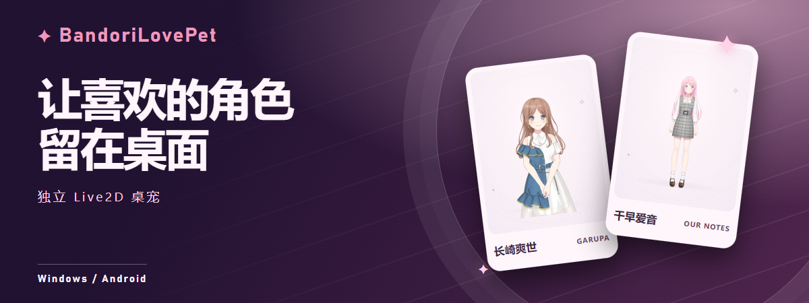
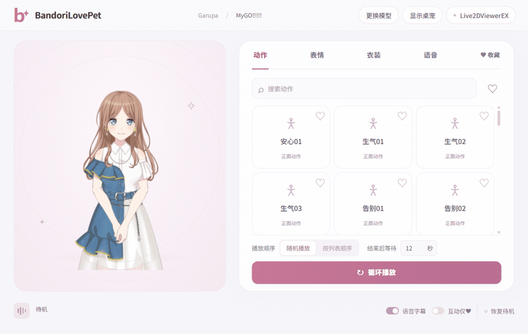
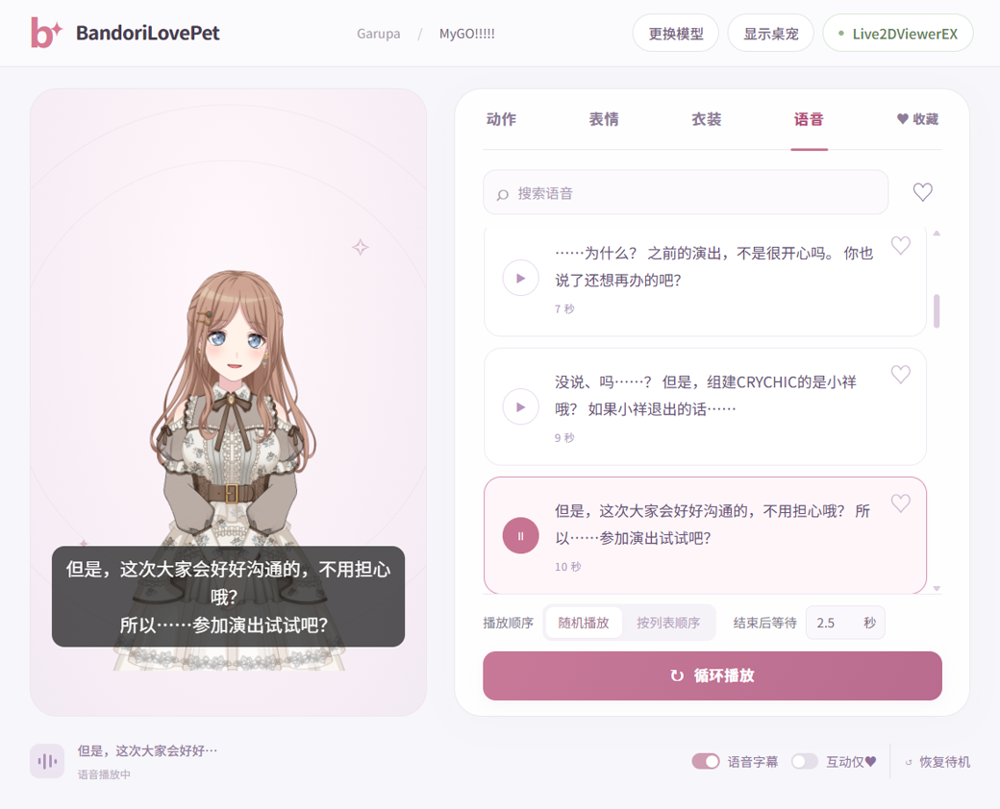

# BandoriLovePet



BanG Dream! Live2D 桌宠。导入 Garupa 或 OurNotes 的单角色 ZIP，即可预览、换装、播放动作和语音，也能把角色留在桌面。

**[Windows 安装包](https://github.com/jiangyunxi222/BandoriLovePet/releases/tag/Windows_V261116)** · **[Android 预发布版](https://github.com/jiangyunxi222/BandoriLovePet/releases/tag/Android_V261116)**

## 角色库

- **Garupa** 收录 Poppin’Party、Roselia、Pastel＊Palettes 等《少女乐团派对！》角色。[角色 ZIP](https://github.com/jiangyunxi222/GarupaLive2D/releases/latest)
- **OurNotes** 收录夢限大みゅーたいぷ、millsage、一家Dumb Rock! 等《BanG Dream! Our Notes》角色。[角色 ZIP](https://github.com/jiangyunxi222/OurNotesLive2D/releases/latest)

MyGO!!!!! 与 Ave Mujica 在两库均有收录，模型和衣装随游戏版本而异。

## 角色实录



*MyGO!!!!! · 长崎爽世（Garupa）· Windows 动作与换装实录*

## 安装与使用

### Windows

1. 运行 `BandoriLovePet-Setup.exe`。安装向导可选目录和桌面快捷方式。
2. 点「选择模型」导入从角色发布页下载的单角色 ZIP，再点「显示桌宠」。独立桌宠无需安装 Live2DViewerEX。
3. 左键拖动角色，**Shift + 滑轮**缩放，点击腿部打开完整角色包的菜单。右击托盘 **b\*** 可调大小和层级。

关闭主窗口会退到托盘。「退出桌宠」收起角色，「退出程序」关闭软件。覆盖安装前先退出旧版并沿用原目录。可在 Windows「设置 → 应用 → 已安装的应用」卸载，模型与个人设置会保留。

### Android

1. 在 Android 11 及以上安装 `BandoriLovePet.apk`，打开应用并选择角色 ZIP。
2. 点「显示桌宠」并授予浮窗权限。单指拖动，双指缩放。
3. 完整角色包点腿部开菜单。第三方模型点角色后，胸前会短暂出现三点按钮。可从应用或桌宠通知退出。

## 导入格式

| 文件 | Windows | Android |
| --- | --- | --- |
| Garupa / OurNotes 发布页的单角色 ZIP | 直接导入，含角色控制 | 直接导入，含角色控制 |
| 解压后的 `00_integrated.model.json` / `00_integrated.model3.json` | 选择父模型 JSON，保留完整角色目录 | 请选择原发布 ZIP |
| 普通 Live2D 模型 JSON | 选择 `*.model.json` / `*.model3.json`，保留相对路径 | 请选兼容的 LPK / WPK |
| LPK / WPK | 预览和独立桌宠 | 预览和独立桌宠 |

角色 ZIP 请从发布页的 **Assets** 下载。第三方 ZIP 在 Windows 上需先解压，再选择模型 JSON。

创意工坊 LPK 如需 `config.json`，请把对应配置放在同目录。普通 Cubism 3 及以上模型首次导入需联网获取官方运行库。经典 Cubism 2 需先导入一次完整角色发行包。

## Live2DViewerEX 连接（Windows）

1. 解压角色 ZIP，在 ViewerEX 中加载 `00_integrated` 父模型。
2. 在 BandoriLovePet 导入同一角色，点击「Live2DViewerEX」。连接后可发送动作、换装和语音指令，应用内同步播放状态和字幕。
3. 再点连接按钮断开。独立桌宠由「显示桌宠」「退出桌宠」控制。创意工坊订阅和壁纸模式可在 ViewerEX 中使用。



<details>
<summary>更新角色包控制台</summary>

先安装 BandoriLovePet 并关闭该角色的 Control Panel。从 [Windows 发布页](https://github.com/jiangyunxi222/BandoriLovePet/releases/tag/Windows_V261116) 下载 `Update-ControlPanel.ps1`，再把角色目录传给脚本。

```powershell
pwsh -File .\Update-ControlPanel.ps1 -RoleDirectory "D:\我的角色\若叶睦"
```

重新打开角色的 Control Panel。顶部提供「显示桌宠」和「Live2DViewerEX」入口。连接独立桌宠前，请先在 BandoriLovePet 导入同一角色。

</details>

<details>
<summary>开发与构建</summary>

Windows 构建需要 Windows x64、Python、PyInstaller、[Inno Setup](https://jrsoftware.org/inno-setup/downloads)、[Electron rcedit](https://github.com/electron/rcedit/releases) 和解包后的 Windows x64 Electron。若 Inno Setup 缺简体中文语言文件，从 [Inno Setup 翻译页](https://jrsoftware.org/inno-setup/translations) 取 `ChineseSimplified.isl`，放入其 `Languages` 目录。

```powershell
python -m pip install pyinstaller
pwsh -File .\build.ps1 -ElectronDirectory "D:\electron-win32-x64" -ResourceEditor "D:\rcedit-x64.exe" -InnoSetupCompiler "C:\Program Files (x86)\Inno Setup 6\ISCC.exe"
```

Windows 输出为 `dist/BandoriLovePet-Setup.exe`。Android 构建见 [Android 分支说明](https://github.com/jiangyunxi222/BandoriLovePet/blob/feature/android-apk/android/README.md)。第三方组件见 [THIRD_PARTY_NOTICES.txt](panel/THIRD_PARTY_NOTICES.txt)。

</details>

角色素材随角色包提供，演示中的角色与游戏素材权利归原权利人。这是同好制作的工具项目。
